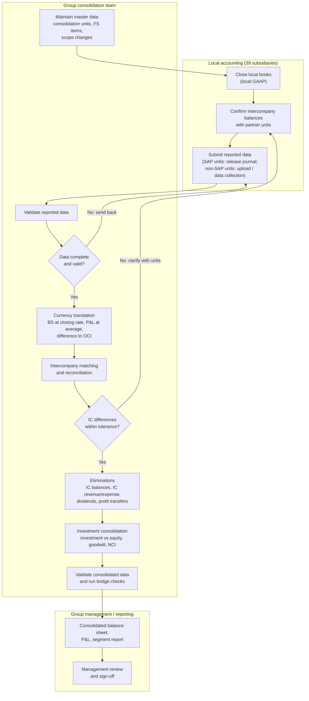

# Step 4 – Group close process and SAP S/4HANA Group Reporting mapping

Case: Koenig & Bauer Group, FY2025 (public data only)
Builds on: `01_consolidation_units_FY2025.xlsx`, `02_consolidation_bridge_FY2025.xlsx`, `03_currency_translation_FY2025.xlsx`

---

## 1. Why this step

Steps 1–3 showed the accounting logic of consolidation with real figures. In a real company that logic runs every month as a process, with people, deadlines and a system. This step describes that process and maps each part to SAP S/4HANA Finance for Group Reporting, so the project shows both sides: what is calculated and how it would run in the system.

Context from the public reports: Koenig & Bauer is rolling out SAP S/4HANA at its largest site (Radebeul) and runs group consolidation in a separate tool (OneStream). So this mapping is a design exercise ("how would this group look in SAP Group Reporting?"), not a description of what the company actually uses.

---

## 2. The monthly group close – process model

Three roles: the local accounting teams of the 39 subsidiaries, the central group consolidation team, and group management / reporting.

A typical close calendar for a group of this size (illustrative, not company data):

| Working day | Activity |
|---|---|
| Day 0 | Scope and master data check (new units such as Kyana GmbH, Dry Coating GmbH, KR, JP) |
| Day 1–3 | Local close, intercompany confirmation |
| Day 3–4 | Data submission and validation |
| Day 4–5 | Currency translation, intercompany matching, clarification of differences |
| Day 5–6 | Eliminations, investment consolidation, validation |
| Day 6–7 | Group reports, management review |

---

## 3. Mapping: project steps → SAP Group Reporting

| Process step | What it does in this case | SAP Group Reporting element | Project file |
|---|---|---|---|
| Master data | 40 consolidation units, ownership %, currencies, direct/indirect holding | Consolidation units, consolidation group, FS items, group currency (EUR), consolidation version | 01 |
| Scope changes | 4 units new in 2025, Canada split out of the US unit | Consolidation group structure with first-consolidation date; preparation for consolidation group changes | 01 |
| Data collection | Parent HGB figures, subsidiary equity | Release of universal journal entries (SAP-based units); flexible upload or Group Reporting Data Collection (non-SAP units) | 02 |
| Validation | Checks before consolidation starts | Data validation rules in the Data Monitor | 02 |
| Currency translation | USD and CHF examples, ECB rates, OCI effect –4.4 / +0.9 €m | Currency translation task with translation methods and exchange rate types (closing, average); posting to translation-difference FS items | 03 |
| Intercompany matching | Parent owes subsidiaries €180.0m, is owed €96.2m | Intercompany Matching and Reconciliation (matching rules, reconciliation cases); partner unit on each line item | 02 |
| IC elimination | IC balances, dividends €9.4m, profit transfer €16.0m, loss absorption –€8.9m | Elimination / reclassification methods in the Consolidation Monitor | 02 |
| Investment consolidation | Investments €415.9m vs subsidiary equity, goodwill €39.8m, NCI €0.6m | Consolidation of investments (rule-based), ownership data, goodwill and NCI postings | 02 |
| Consolidated validation | Equity bridge, NCI plausibility check | Validation of consolidated data | 02 |
| Reporting | Group balance sheet, P&L, segments | Group Data Analysis, consolidated reports, Analysis for Office / SAP Analytics Cloud | 02 |

---

## 4. Fit-gap notes (what needs special attention in this group)

These are the points where this group would not run "out of the box". They are the questions I would raise in a real implementation workshop.

1. **Indirect holdings.** Seven units are held through other subsidiaries (e.g. via the Swiss holding). Ownership data must model the full chain, otherwise investment consolidation under-eliminates. This is the largest unexplained item in my equity bridge.
2. **German profit and loss transfer agreements.** Profit transfers (€16.0m) and loss absorption (–€8.9m) between the parent and German subsidiaries need their own FS items and elimination logic, separate from dividends.
3. **Hyperinflation (Turkey, IAS 29).** The Turkish unit has to be restated before translation. How this is handled in the system (inside Group Reporting or before data is submitted) needs to be clarified early.
4. **Local GAAP vs IFRS.** Units report under local GAAP (e.g. HGB). Either local teams submit IFRS-adjusted data, or GAAP adjustments are posted centrally. This decides who owns the adjustments.
5. **Mixed system landscape.** Some units on SAP S/4HANA, others not. Data collection needs two paths (integrated release and upload / data collection forms) with one common validation.
6. **Scope changes during the year.** New units need a clear first-consolidation date and opening balances; units being restructured (Albert-Frankenthal closure, Coding review) may need deconsolidation later.

---

## 5. What public data could and could not show

| Could show | Could not show |
|---|---|
| Group structure, ownership, currencies | Subsidiary trial balances and P&L |
| Parent HGB balance sheet and P&L | Intercompany balances between subsidiaries |
| Parent's intercompany totals | Which subsidiary holds the indirect units |
| Group IFRS statements, goodwill, NCI | The company's internal exchange rates |
| Translation logic with ECB rates | HGB → IFRS adjustments per unit |

The right-hand column is exactly the data a group reporting team receives through the close process above. That is why the bridge in step 2 ends with an unexplained remainder, and why the remainder is documented rather than forced to zero.

---

*Sources: Koenig & Bauer Annual Report 2025 and Summary Annual Report 2025; ECB reference rates. SAP terms refer to SAP S/4HANA Finance for Group Reporting as described in SAP's public learning material (learning.sap.com).*
